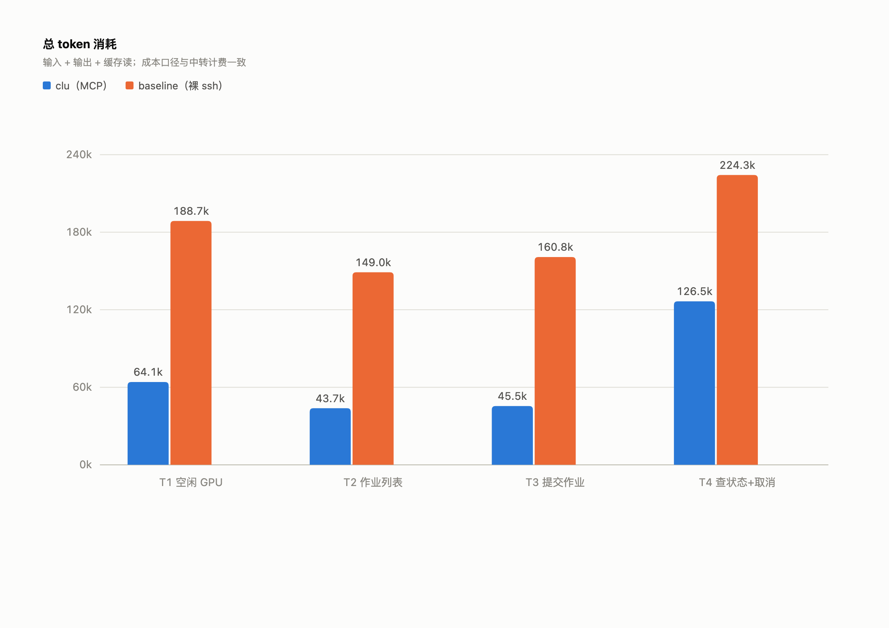
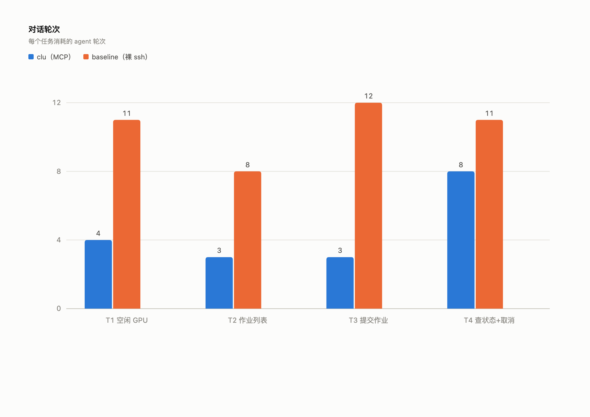

# clu

[简体中文](README.md) | English

> SSH session keep-alive/management + an AI agent capability layer for Slurm clusters and plain servers.
> A single-user tool for students and researchers: any MCP client (Claude Code, Codex, …) and the `clu` CLI share one daemon.

**Faster, cheaper**: structured MCP tools give the agent the answer in one call instead of many rounds of hand-assembled ssh/sbatch commands.
Measured on 4 cluster tasks (Claude Code CLI + deepseek-v4-flash): **39% of the tokens, 44% of the wall time, 43% of the turns**
(versus a bare-ssh baseline — see [Benchmark](#benchmark-faster-and-cheaper-2026-10-23)).

---

## 1. What it solves

- **AI connected to your cluster**: say "check the queue", "grab an A100", "upload the dataset" in Claude Code —
  clu does it over your own SSH channel; no keys are handed to any cloud service
- **Sessions that survive**: interactive allocations (salloc) run inside a remote tmux; closing the laptop or losing
  the network does not lose the allocation
- **Connection reuse**: a local daemon holds a persistent connection pool; commands return immediately and reconnect automatically
- **Execution ledger**: every action is written to SQLite, so "what happened to that job last time" is answerable across sessions

## Benchmark: faster and cheaper (2026-10-23)

Real sessions: **Claude Code CLI 2.1.309** + model **deepseek-v4-flash**.

**4 test tasks** (one `claude -p` single-turn session per task, `--max-turns 12`):

1. How many GPUs are free in the `gpu-a100` partition of the `cluster`, and which nodes have free ones
2. List all my current jobs and their states
3. Submit a test job to the `xxx` partition (1 CPU, 5 minutes, `sleep 240`) and report the job id
4. Check that job's state and output log, then cancel it

Cost is measured in tokens (input + output + cache reads — the same basis the relay bills on).






| Metric | clu | baseline | Ratio |
|---|---|---|---|
| Total tokens | 279,816 | 722,679 | **39%** |
| Total wall time | 81s | 185s | **44%** |
| Total turns | 18 | 42 | **43%** |

**Correctness**: both groups were 4/4 correct; every submitted job really existed (cross-checked via squeue and the
clu ledger), and every cancel took effect.

**Why it is faster and cheaper**: `resources`, `jobs`, `submit` and friends fold "fetch raw data → parse → assemble
the command" into a single call — the agent no longer probes with several rounds of `sinfo`/`scontrol`/`squeue`.
Turns dropped from 42 to 18 and tokens from 723k to 280k; the MCP tool schemas themselves take only ~3.9k tokens,
far below the cost of extra command rounds.

Note: single-run small sample; absolute numbers vary with the model and relay, while the relative gap (2–3×) has
been stable across runs.

---

## 2. Installation

### Option 1: single-file binary (recommended, no Python required)

```bash
# macOS / Linux: download the matching binary into ~/.local/bin
curl -fsSL https://raw.githubusercontent.com/QiandingHuang666/clu-ssh/main/packaging/install.sh | sh

# Pin a version or install directory:
# CLU_VERSION=v0.1.6 CLU_PREFIX=/usr/local/bin sh packaging/install.sh
```

```powershell
# Windows (PowerShell)
irm https://raw.githubusercontent.com/QiandingHuang666/clu-ssh/main/packaging/install.ps1 | iex
```

The Releases page carries artifacts for every platform: `clu-<version>-<os>-<arch>.tar.gz` (`.zip` on Windows)
with matching `.sha256` files. `clu-mcp` and `clu` are the same binary (dispatched by `argv[0]`).

### Option 2: uv / pipx (Python ≥ 3.11)

```bash
uv tool install clu-ssh
# or: pipx install clu-ssh
```

### Option 3: from source

```bash
git clone https://github.com/QiandingHuang666/clu-ssh
cd clu-ssh && uv sync
alias clu='uv run --project /path/to/clu-ssh clu'
```

Requirements: SSH **public-key authentication** (password-only connections are not supported). On Windows,
`clu attach` needs the system OpenSSH client.

### Connect an MCP client

`clu-mcp` is a standard **stdio MCP server** (server name `clu`). It starts the local daemon automatically and needs
no environment variables.

**Claude Code**

```bash
claude mcp add --scope user clu -- clu-mcp        # user scope
claude mcp add clu -- clu-mcp                     # project scope
# Source installs: use the absolute path, e.g. /path/to/clu-ssh/.venv/bin/clu-mcp
```

**Codex CLI** — edit `~/.codex/config.toml`:

```toml
[mcp_servers.clu]
command = "clu-mcp"
args = []
```

**Other MCP clients** (Claude Desktop / Cursor / Cline / Windsurf, …) — add to the MCP configuration:

```json
{
  "mcpServers": {
    "clu": { "command": "clu-mcp", "args": [] }
  }
}
```

Common locations: Claude Desktop (macOS `~/Library/Application Support/Claude/claude_desktop_config.json`,
Windows `%APPDATA%\Claude\claude_desktop_config.json`), Cursor (`~/.cursor/mcp.json` or a project `.cursor/mcp.json`);
Cline / Windsurf accept the same entry in their MCP settings UI.

After connecting, run `clu connection import` to configure connections; the available tools are listed in
[§6 MCP tool reference](#6-mcp-tool-reference).

## 3. Quick start (five minutes)

```bash
# 1. Import your existing ssh config (one-off copy; only public-key-reachable entries)
clu connection import

# 2. Mark Slurm entries as cluster (import defaults to an IP heuristic: instance/local)
clu connection add gzu --host hpc.example.edu.cn --user you --port 22 --kind cluster
#    or edit the imported entry's kind in ~/.config/clu/connections.toml

# 3. Start the daemon (every command auto-ensures it afterwards; usually not needed manually)
clu server ensure

# 4. Try it
clu connection check gzu          # a real connection through the pool
clu exec gzu "squeue -u $USER | head"
```

## 4. Core concepts

| Concept | Description |
|---|---|
| **daemon** | A long-lived local process holding the SSH pool, tmux sessions, forwards and ledger. Any command auto-starts it when absent (`clu server ensure`); `clu server stop` stops it |
| **connection** | A remote host in `~/.config/clu/connections.toml` with a `kind`: `cluster` (Slurm, enables job tools) / `instance` (rented box) / `local` (LAN) |
| **jump host** | A connection may set `proxy` to another connection (single-hop ProxyJump); authentication and tunneling reuse the pool |
| **profile** | School/cluster customizations (public resource dirs, heavy-operation lists, preempt partitions) attached to a connection — zero hard-coding |
| **ledger** | Every action is written to `~/.local/share/clu/ledger.sqlite3`; `ledger_query` filters by connection/keyword/job id |
| **known_hosts** | Host keys are recorded on first connect and strictly verified afterwards — **a change is rejected** (MITM protection) |

## 5. CLI reference

### 5.1 Cheat sheet

```
clu server   ensure | status | stop
clu connection  import | add | remove | list | check
clu exec     LABEL COMMAND...
clu resources LABEL [filters]
clu alloc    LABEL [resources]
clu attach   LABEL PURPOSE
clu jobs     LABEL [--states RUNNING,PENDING]   live queue (squeue)
clu submit   LABEL [-f file | --script text | stdin]
clu job      list | log
clu session  list | release
clu forward  add | list | remove
```

### 5.2 Details

**Connections**

```bash
clu connection import [--config ~/.ssh/config] [--overwrite]   # one-off import of public-key entries
clu connection add gzu --host hpc.example.edu.cn --user you --kind cluster \
                     [--port 22] [--identity ~/.ssh/id_ed25519] [--proxy jumplabel] [--profile name]
clu connection remove gzu
clu connection list                # read the config file (+ pool state when the daemon is up)
clu connection check gzu           # a real connect through the pool, running `true`
```

**Remote execution**

```bash
clu exec gzu "squeue -u $USER"       # gated by the safety rules (dangerous / login-node heavy operations are refused)
clu exec gzu "df -h" --timeout 30
```

**Resource queries**

```bash
clu resources gzu                                  # partition aggregate (compact view)
clu resources gzu --partition gpu-a100             # a single partition
clu resources gzu --cpu-free                       # nodes with free CPUs
clu resources gzu --cpu-gpu-free --gpu-only        # CPU+GPU free, GPU nodes only
clu resources gzu --fully-idle                     # CPU and GPU entirely idle
clu resources gzu --nodes                          # include the per-node table
```

**Preemption / interactive resources**

```bash
clu alloc gzu                                 # GPU first, fall back to CPU when no GPU is free
clu alloc gzu --gpu --gpus 2 --cpus 16        # pin counts
clu alloc gzu --cpu --cpus 8                  # CPU only
clu alloc gzu -p gpu-a100-8card --purpose train --wait 60
# after `granted`:
clu attach gzu train        # enter a compute-node shell (exit releases it)
clu session list gzu        # managed sessions (--deep scans every connection)
clu session release gzu train       # release one
clu session release gzu --all       # release all on that connection
```

Selection logic: partitions are ranked by **per-node satisfiability** (both GPU count and CPU cores must fit);
when a submission is bounced the next candidate is tried. Default cores = `min(node total cores ÷ node GPUs, node free cores)`.

**Batch jobs**

```bash
# From a file (recommended)
clu submit gzu -f train.slurm --name train -p gpu-a100 --gpus 1 -c 16 -t 4:00:00

# From stdin
echo -e '#!/bin/bash\necho hi' | clu submit gzu --name echo-test -p cpu56c256g -c 1 -t 0:05:00

# Inline
clu submit gzu --script "#!/bin/bash
hostname
" --name probe

clu jobs gzu                  # live queue (all jobs of the current user)
clu jobs gzu --states RUNNING # running only
clu job list gzu              # ledger (script path/resources/node/state/submitted time)
clu job list gzu --active     # non-terminal only
clu job log gzu 12345         # read ledger job stdout/stderr (--tail N)
```

Submit behaviour:
- Scripts and logs land on the remote at `<home>/.clu/jobs/<connection>/<name>-<timestamp>-<random>.sh|-%j.out|-%j.err`
- Resource parameters are injected as `#SBATCH` directives after the shebang; same-kind directives already in the
  script are respected
- Script content, paths, resources and state are written to the local `jobs` ledger; the daemon verifies state every
  60s (squeue live, sacct for finished jobs) — `job list` shows the latest verification
- The safety gate also applies to script content (dangerous commands are refused)

**Port forwarding**

```bash
clu forward add gzu 10.0.0.5 8888 --local-port 18888
clu forward list
clu forward remove fwd-1
```

## 6. MCP tool reference

`clu-mcp` provides 16 tools; ○ marks read-only tools (eligible for no-confirmation in client permission settings).
All write operations pass the daemon-side safety gate (see §8).

| Tool | Description | Key parameters |
|---|---|---|
| ○ `connection_list` | Connections and pool health | — |
| `exec` | Run one remote command (safety gate enforced server-side) | `connection`, `command`, `timeout?` |
| ○ `jobs` | Current user's jobs (live squeue) | `connection`, `states?` |
| ○ `status` | Partition and queue overview | `connection` |
| ○ `resources` | **Capacity**: per-partition CPU/GPU total/allocated/free and node counts (single round-trip, authoritative AllocTRES); `filter=cpu_free` / `cpu_gpu_free` / `fully_idle` narrow the scope from the first call, `gpu_only` stacks; filters include the node table | `connection`, `partition?`, `filter?`, `gpu_only?`, `include_nodes?` |
| `submit` | Submit a job: script and stdout/stderr land in remote `~/.clu/jobs/<connection>/`; content and paths go to the local ledger | `connection`, `script`, `name?`, `partition?`, `nodes?`, `cpus?`, `gpus?`, `time_limit?` |
| `cancel` | Cancel a single job | `connection`, `job_id` |
| ○ `job_list` | Job ledger: script path and content, resources, nodes, log paths, last verified state | `connection?`, `active_only?` |
| ○ `log` | Job stdout (locates the path and tails it) | `connection`, `job_id`, `tail?` |
| `alloc` | **Preemption interface (auto-selects, no prior query)**: default GPU first then CPU; `resource=gpu/cpu` pins the kind; partitions ranked by per-node free resources, bounced submissions rotate candidates; after `granted`, `clu attach` opens a compute-node shell. Default cores = `min(node cores ÷ GPUs, free cores)` (profile-overridable) | `connection`, `purpose?`, `resource?`, `gpus?`, `cpus?`, `partition?`, `wait?` |
| ○ `session_list` | Managed sessions (tmux / pty-daemon / setsid) | `connection?` |
| ○ `session_info` | Session detail: state, job/node, log tail | `connection`, `purpose` |
| `session_release` | Release a session (resources returned) | `connection`, `purpose` |
| `upload` / `download` | SFTP transfer; parent directories are created on both sides | `connection`, `local_path`, `remote_path` |
| ○ `ledger_query` | Search past executions (cross-session memory) | `connection?`, `kind?`, `keyword?`, `job_id?`, `since?`, `limit?` |

## 7. Typical scenarios

**Queue / submit / logs** (say it to Claude Code, or run it yourself):
> "Use clu to check gzu's queue and free GPUs"
> "Submit this training script to gzu's gpu partition, 2 cards"
> "Tail 100 lines of job 12345's log"

**Grab a card / resources** (one interface, auto-selecting):
> "Grab a GPU with clu" → `alloc()` (GPU first, CPU fallback when no GPU is free)
> "Grab 2 A100s" → `alloc(gpus=2)`; "Grab 8 CPU cores" → `alloc(resource="cpu", cpus=8)`
> Partition auto-selected (per-node free resources); an explicit `partition=` is used directly.
> After `granted`, `clu attach cluster-r <purpose>` **drops you into a compute-node shell**; `exit` releases it.
> "Release the xxx session" when done (`session_release`). Bounced submissions rotate candidate partitions automatically.

**Surviving disconnects**: alloc sessions live in a remote tmux — a dropped network, a new location, or restarting
Claude Code changes nothing; `clu session list` shows them at any time.

**Batch submission**:
> "Submit this script to the gpu partition with 2 cards"
> `submit(connection="cluster-r", script=..., name="train", partition="gpu-a100", gpus=1, cpus=16)`
> or on the CLI: `clu submit cluster-r -f train.slurm -p gpu-a100 --gpus 1 -c 16`
>
> Scripts and logs land in remote `~/.clu/jobs/<connection>/`; `clu job list` shows state (verified by the daemon
> every 60s), and `clu job log cluster-r <job_id>` reads stdout/stderr.

**File transfer**:
> "Upload ./data.csv to gzu:~/data/" / "Download gzu:~/result.tar to ./out/"

**Port forwarding** (reach web services inside the cluster):
```bash
clu forward add gzu 10.0.0.5 8888 --local-port 18888   # open http://127.0.0.1:18888
clu forward list && clu forward remove fwd-1
```

## 8. Security model

Two layers (DESIGN §8):

1. **Client tool permissions** (primary): read-only and write tools are declared separately, so no-confirmation
   allowlists can be configured per client
2. **Server-side hard rules** (cannot be bypassed; effective for every client):
   - **Dangerous blacklist**: recursive deletion of root/system/home directories, `mkfs`, `dd of=/dev/*`,
     `shutdown/reboot`, `scancel --all`, fork bombs, … → refused outright
   - **Login-node heavy-operation guard** (disable with profile `heavy_guard = false`): training/compiling/installing
     on a `cluster` connection (torchrun, `make -j`, `pip install`, … — extensible per profile) → refused with a
     submit/alloc suggestion

Authentication is public-key only, reusing ssh-agent and `~/.ssh`; clu stores no keys.

## 9. Directories and configuration

| Path | Contents |
|---|---|
| `~/.config/clu/connections.toml` | Connections and profiles (hand-editable, comments preserved) |
| `~/.config/clu/known_hosts` | Host keys (accept-new) |
| `~/.local/share/clu/ledger.sqlite3` | SQLite: execution ledger + session registry + job ledger |
| `$XDG_RUNTIME_DIR/clu/` (or `/tmp/clu-$UID/`) | daemon socket and `daemon.log` (POSIX) |
| `%APPDATA%\clu` / `%LOCALAPPDATA%\clu` / `%TEMP%\clu` | Windows config / data / runtime directories |
| Windows transport | The daemon listens on a random 127.0.0.1 port; `daemon.port` holds the port and a one-time token (first-line handshake) |

`CLU_CONFIG_DIR` / `CLU_DATA_DIR` / `CLU_RUNTIME_DIR` relocate these directories (used by tests).

### 9.1 Database tables (`ledger.sqlite3`)

**`exec_records`** — execution log (searched by `ledger_query`)

| Field | Description |
|---|---|
| `id` / `ts` | Auto-increment key / UTC ISO8601 time |
| `connection` | Connection label |
| `kind` | exec / submit / alloc / release / cancel / upload / download / forward |
| `command` | Command or script summary |
| `exit_code` / `duration_ms` | Exit code / duration |
| `job_id` | Associated Slurm job (nullable) |
| `summary` | One-line summary |

**`sessions`** — managed session registry, primary key `(label, purpose)`

| Field | Description |
|---|---|
| `label` / `purpose` | Connection / purpose name (tmux session `clu/<label>/<purpose>`) |
| `job_id` / `node` / `partition` | Allocated job, node and partition |
| `gpus` / `cpus` | Requested resources |
| `state` | pending / granted (listed as stale when the connection is unreachable) |
| `updated_ts` | Last verification time |

**`jobs`** — batch job ledger, primary key `(connection, job_id)`

| Field | Description |
|---|---|
| `name` | Job name |
| `script_path` / `script` | Absolute remote script path / full script content |
| `partition` / `requested_nodes` / `cpus` / `gpus` | Requested resources |
| `node_list` | Actually allocated nodes (verified via squeue/sacct) |
| `stdout_path` / `stderr_path` | Absolute log paths (`%j` resolved to the job id) |
| `state` | PENDING/RUNNING/COMPLETED/FAILED/CANCELLED/TIMEOUT/… |
| `exit_code` | sacct exit code (e.g. `0:0`) |
| `submitted_ts` / `updated_ts` | Submitted / last verified time |

Remote directories: `~/.clu/jobs/<connection>/` (scripts and logs), `~/.clu/alloc/<connection>/<purpose>.log` (salloc logs).

## 10. Troubleshooting

| Symptom | Handling |
|---|---|
| `daemon not running` | `clu server ensure`; check `daemon.log` |
| Connection in backoff (`retry_after`) | A recent failure; wait the reported seconds, or `clu server stop && clu server ensure` to reset the pool |
| `Host key ... changed` | The host key changed. After confirming a legitimate cause (reinstall, etc.) remove that line from `~/.config/clu/known_hosts` |
| Session stays pending after salloc | Normal queueing; check `clu session list`, or ask the agent for `session_info`; timed-out sessions are retained |
| salloc reports "--gres=gpu:N must be input" | The cluster's submit plugin requires the classic syntax — clu already sends `--gres=gpu:N` |
| `hostname` is the login node after attach | Fixed: clu uses `srun bash` to land on the compute node (clusters without SallocDefaultCommand run salloc locally) |
| No prompt / config missing after attach | Fixed: `srun --pty bash -l` provides a real terminal and a login shell; logging uses tmux pipe-pane (a tee pipe makes srun reject --pty) |
| Forwarding stops working | Forwards bind to a connection; reconnect and re-add with `clu forward add` (minimal-set limitation) |
| `clu session list` reports an unreachable connection | Expected degradation: that host is off/unreachable; its sessions are skipped while others list normally (parallel probes, 6s cap) |
| squeue output fails to parse | Local Slurm modifications vary widely — send the raw output of `clu exec gzu "squeue -u you"` to the author |
| Free-GPU counts look wrong | `resources` reads allocated GPUs from node AllocTRES (`gres/gpu=N` is the total in `scontrol show nodes -o`). Cross-check with `clu exec gzu "scontrol show node <node> -o"`; clusters without AllocTRES report an estimate |
| The agent retries the same command in a loop | Circuit breaker: the same command executed 5 times in 120s returns `loop_detected` and tells the model to summarize existing results; different commands are unaffected |
| The remote has no tmux | `alloc` reports it clearly and suggests `exec`/`submit`; query tasks on plain servers use `exec` and need no tmux |

## 11. Known limitations (v1)

- File transfer is single-file SFTP; incremental directory sync (rsync) is planned for v1.1
- Jump hosts are single-hop (one ProxyJump); multi-hop chains are on the roadmap
- Forwarding is local `-L` only; SOCKS/remote `-R` are on the roadmap
- Platforms: macOS + Linux + Windows (Windows transport is 127.0.0.1 TCP + one-time token; see `daemon.port` in §9)
- Password-authenticated connections are unsupported (run `ssh-copy-id` first)
